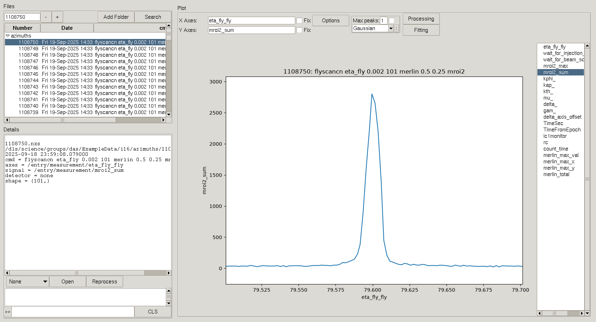

[](https://opensource.org/licenses/Apache-2.0)
[](https://github.com/DiamondLightSource/mmg_tk_dataviewer/actions/workflows/tests.yml)

# Tk DataViewer for mmg_toolbox
A simple tkinter dataviewer for NeXus files from beamlines at Diamond Light Source in
the Magnetic Materials Group, built on [mmg_toolbox](https://github.com/DiamondLightSource/mmg_toolbox).



Source          | <https://github.com/DiamondLightSource/mmg_tk_dataviewer>
:---:           | :---:
mmg_toolbox     | <https://github.com/DiamondLightSource/mmg_toolbox>
Documentation   | <https://diamondlightsource.github.io/mmg_toolbox>


### Installation
*Requires:* Python >=3.11, h5py, matplotlib, pillow, mmg_toolbox
```bash
python -m pip install git+https://github.com/DiamondLightSource/mmg_tk_dataviewer.git
```

### Usage
```bash
$ dataviewer                     # experiment selection window for the default beamline
$ dataviewer i16                 # experiment selection window for a specific beamline
$ dataviewer /path/to/experiment # data viewer for a folder of NeXus files
$ dataviewer /path/to/scan.nxs   # NeXus tree viewer for a single file
$ dataviewer --help              # list options and available beamlines
```

Or from Python:
```python
from mmg_tk_dataviewer import run, create_data_viewer, create_nexus_viewer

run()  # same as the dataviewer command
create_data_viewer('/path/to/experiment')
create_nexus_viewer('/path/to/scan.nxs')
```

### @DLS
The dataviewer is available via the module system:
```bash
$ module load mmg
(python)$ dataviewer
```
