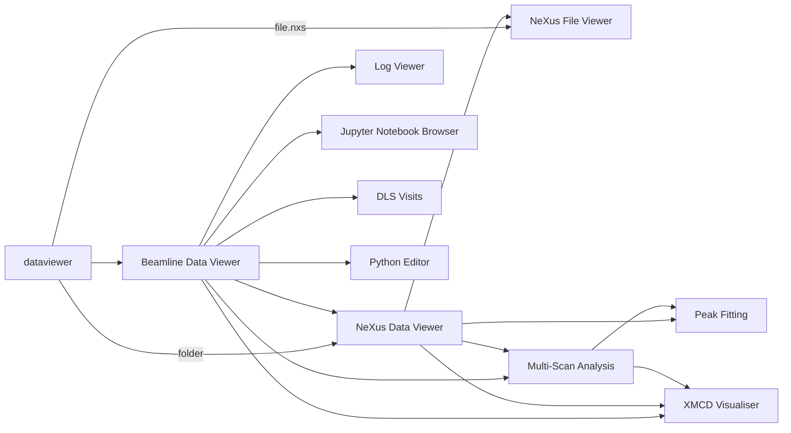
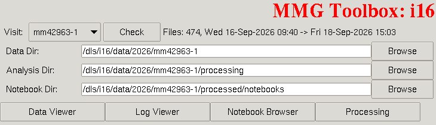
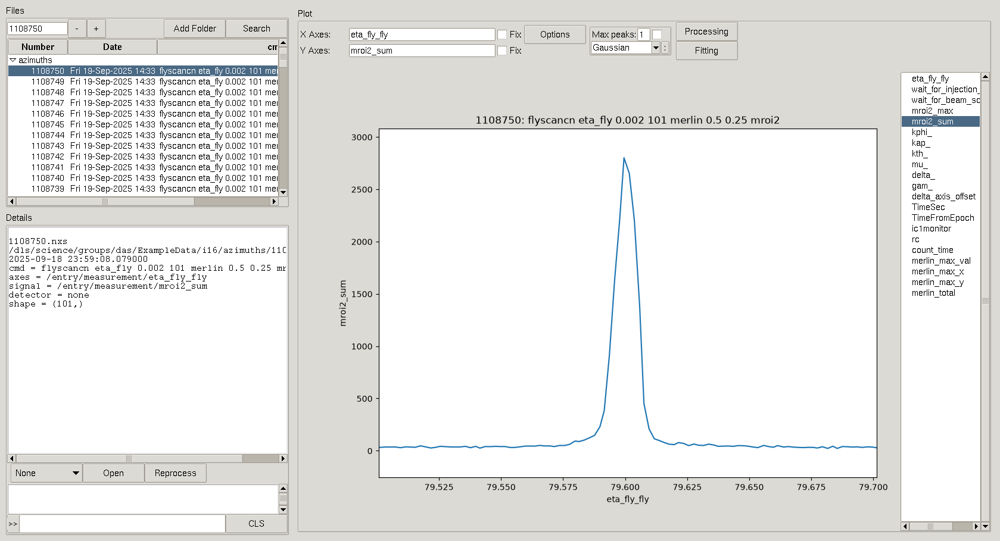
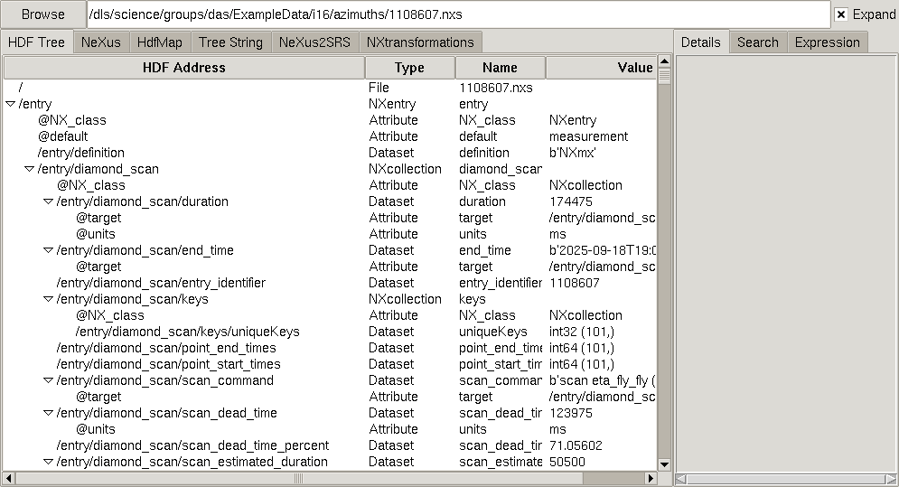

# DataViewer Windows

A guide to each window in the mmg_tk_dataviewer, what it shows, and how to open it.

Most windows share a few standard menus:

- **Config**: *Edit Config.* opens the [Config Editor](#config-editor); *Reset Config.* restores the beamline defaults.
- **Themes**: switch the tkinter colour theme.
- **Help**: *Docs* opens the mmg_toolbox documentation; *About* shows version information.

---

## Beamline Data Viewer (title window)

**Opened by:** `dataviewer` or `dataviewer <beamline>`. Code: `apps/experiment.py`, `widgets/title_window.py`.

This is the start-up window for an experiment. It shows the current beamline as a title, then:

- **Visit**: a dropdown of the beamline's recent DLS visits, plus a `default` entry. *Check* opens the NeXus File Browser on the data folder, and a summary line shows what the folder contains.
- **Data Dir / Analysis Dir / Notebook Dir**: the experiment's data folder, its `processing` folder and its `processed/notebooks` folder. Choosing a visit or pressing Enter in *Data Dir* fills in the other two when they exist. Each has a *Browse* button.
- **Buttons**: *Data Viewer*, *Log Viewer*, *Notebook Browser* and *Processing* (which opens [Multi-Scan Analysis](#multi-scan-analysis)).

Menus:

- **File**: File Browser, NeXus File Browser, NeXus File Viewer, Jupyter Browser, Data Viewer, Range selector, Log viewer, Visit Viewer.
- **Processing**: Script Editor, XMCD Visualiser, *Create Example Scripts* (writes the beamline's example scripts into the analysis folder), *Open a terminal*, start Jupyter in the processing or notebooks folder, and stop Jupyter servers.
- **Recent Files**: the last 10 data folders opened in the Data Viewer.
- **Beamline**: switch to another beamline's settings and visits.

---

## NeXus Data Viewer

**Opened by:** `dataviewer <folder>`, the *Data Viewer* button, or *File > Data Viewer*. Code: `apps/data_viewer.py`, `widgets/nexus_data_viewer.py`.

The main window for looking through the scans in an experiment. It opens with the first scan selected and has three areas:

- **Files** (top left): every scan in the folder, with metadata columns. Type a scan number in the box and press Enter, or step with **−**/**+**. *Add Folder* adds more folders, and *Search* finds scans by name or value. Select several scans to plot them together. Right-click a scan to copy its path, scan number or metadata, or to open it in the NeXus File Viewer, a plot window or an image window. The list updates as new scans arrive.
- **Details** (bottom left): a text summary of the selected scan, made from the metadata expression in the config. Right-click to *edit Text* (change the expression) or *view Metadata*. Underneath:
  - a small Python terminal (`>>`) for evaluating expressions against the scan, with *CLS* to clear it;
  - a dropdown of Jupyter notebooks already made for this scan, with *Open* and *Reprocess*.
- **Plot / Image** (right): see [Plot and image panels](#plot-and-image-panels).

Menus:

- **File**: New Data Viewer, Add Folder, File Browser, NeXus File Browser, Jupyter Browser, Range selector, Log viewer.
- **Processing**:
  - *Multi-Scan* and *XMCD Visualiser*, both opened with the selected scans;
  - *Script Editor*, *Open a terminal*, and Jupyter start/stop;
  - *Create Script* and *Create Notebook*, which fill a template with the current scans and axes, then open it in the Python Editor or Jupyter.
- **Image**: change image options.
- **Config**, **Themes**, **Help**.

### Plot and image panels

These panels are used in the Data Viewer and in the stand-alone plot windows (`widgets/nexus_plot.py`, `widgets/nexus_image.py`).

**Line plot**

- **X / Y Axes**: choose from the scan's scannables, or type an expression. *Fix* keeps the choice when you change scan, and *Normalise* divides by the configured normalisation factor.
- **Options**: normalise, log, derivative (*Diff*) and inverse.
- **Fitting**: a quick peak fit with *Max peaks* and a model choice; *:* shows the fit results.
- *Processing* opens [Multi-Scan Analysis](#multi-scan-analysis) and *Fitting* opens [Peak Fitting](#peak-fitting), both using the current scans and axes.

**Image**: the detector image for one point in the scan.

- Step through points with the *Index* slider or **−**/**+**.
- **Options**: flip x/y, log, *Diff*, a *Mask <* threshold, colour limits (*clim*, with *Fix*), and a summed-axis label, scale and offset.
- **ROIs**: draw regions of interest on the image, or add the ones saved in the config. Their sums are added to the line plot.
- *Window* opens the image in its own window.

---

## NeXus File Viewer

**Opened by:** `dataviewer <file.nxs>`, *File > NeXus File Viewer*, or *open Treeview* on a scan. Code: `apps/nexus.py`, `widgets/hdf_viewer.py`.

Shows the structure of a single HDF5 or NeXus file.

- *Browse* (or *File > Open*) picks a file, and *Expand* opens the whole tree.
- Tabs give different views of the same file:
  - **HDF Tree**: groups and datasets;
  - **NeXus**: the file's NeXus classes;
  - **HdfMap**: the names that can be used in expressions;
  - **Tree String**: the full file as text;
  - **NeXus2SRS**: an SRS-style data file;
  - **NXtransformations**: the instrument geometry.
- Click a group or dataset to see its attributes and data under **Details**.
- **Search** finds paths, with *Case* and *Word* options.
- **Expression** evaluates a Python expression against the file.

---

## Stand-alone plot windows

**Opened by:** right-click a scan (in the Data Viewer, the File Browsers or the XMCD spectra table) and choose *open Plot* or *open Image*. Code: `apps/nexus.py`.

- **NeXus File Default Plot**: the [line plot panel](#plot-and-image-panels) for one or more files. *File > Open* loads a different file, and *Config. > Edit Config.* changes the settings.
- **NeXus File Image Plot**: the [image panel](#plot-and-image-panels) for one file, with *File > Open*.

---

## File browsers

Code: `apps/file_browser.py`, `widgets/folder_treeview.py`. All three windows share a folder tree with *Browse*, back, up and home navigation, a *Show hidden* option and *Search*. Right-click a folder to copy its path, open a terminal there or start Jupyter there.

- **File Browser**: a general folder and file browser. *Options* filters by file extension.
- **NeXus File Browser**: lists NeXus files and shows the value of a chosen dataset (default `/entry/scan_command`) next to each file. Change the dataset under *Options*. Search by filename or by dataset value. Double-click a file to open it in the NeXus File Viewer.
- **Jupyter Notebook Browser**: browse notebooks, by default in the experiment's `processed/notebooks` folder. Right-click a notebook to open it, or to view an HTML copy.

---

## NeXus Scan Viewer (range selector)

**Opened by:** *File > Range selector*. Code: `apps/scans.py`, `widgets/scan_range_selector.py`.

Builds a list of scan numbers to work with.

- Enter *First*, *Last* and *Step*, then *Generate*. *Get numbers* reads every scan number in the experiment folder.
- *Select Files* opens a table of scans with metadata to pick from.
- *Find* opens **Find Scans**, which matches scans by metadata name or expression, a value and a tolerance.
- *Check* shows the chosen metadata for each scan.

The same widget appears in the *Scan Numbers* section of [Multi-Scan Analysis](#multi-scan-analysis).

---

## Multi-Scan Analysis

**Opened by:** the *Processing* button on the title window, *Processing > Multi-Scan* in the Data Viewer, or *Processing* on the plot panel. Code: `apps/multi_scan_analysis.py`, `widgets/multi_scan_analysis.py`.

Plots and processes a set of scans together.

- **Folders**: data and analysis folders, each with *Browse*.
- **Axes**: X, Y and a metadata value. Each *:* button opens a picker listing the names available in the scan file.
- **Scan Numbers**: the [range selector](#nexus-scan-viewer-range-selector).
- **Plot buttons**: *Plot* (lines with a legend), *Plot lines*, *Plot Meta* (metadata against scan), *Multi-Plot*, *Plot 2D*, *Plot 3D*, *Plot Surf*.
- **Processing buttons**: *Fits* opens [Peak Fitting](#peak-fitting), *Convert to dat* writes the scans as `.dat` files, and *XMCD* opens the [XMCD Visualiser](#xmcd-visualiser).
- **Create**: choose a script or notebook template, fill it with the current scans and axes, and open it.

---

## Peak Fitting

**Opened by:** *Fits* in Multi-Scan Analysis or *Fitting* on the plot panel. Code: `apps/peak_fit_analysis.py`, `widgets/peak_fit_analysis.py`.

Fits peaks in each scan of a series, then plots how the fit results change.

- **Folders**, **Axes** and **Scan Numbers**: as in Multi-Scan Analysis.
- A table of scans shows the peaks found in each. Select a scan to plot it with its fit.
- **Fit Options** for all scans: number of peaks, peak-finding *Power* and *Distance* (*?* explains each), peak *Model* and *Background*.
- The same options can be set for one scan, along with *Select Region*, *Mask Region* and *Reset*.
- *Fit* fits the series and *Results* shows the values. *Plot All* and *Plot Fit results* plot the scans and the fitted parameters against the metadata value.

---

## XMCD Visualiser

**Opened by:** *Processing > XMCD Visualiser* in the title window or Data Viewer, or *XMCD* in Multi-Scan Analysis. Code: `xmcd_visualiser/`.

Processes X-ray magnetic circular dichroism data from pairs of scans with opposite polarisation. *File* has New, Experiment UI and *Set Data path*, plus a save-folder option. The window has three tabs:

- **Average Data**
  - Enter scan numbers or *Load* files. *List* shows the scans, and *Find Pairs* pairs them by polarisation automatically. Pairs can also be added with *+*.
  - *Plot* draws a grid with one subtraction plot per pair. Tick the pairs to include in the average.
  - The averaged spectrum can be added to the comparison, saved as NeXus or CSV, or turned into a script (*Generate Script*).
- **Compare Data**: load processed spectra (*Browse Data*), pick which to show and plot them together, including in 3D.
- **Sum Rule Analysis**: XMCD sum-rule analysis of the two polarisations (*Pol 1*, *Pol 2*). Results can be added to the comparison or saved as NeXus or CSV.

---

## Python Editor

**Opened by:** *Processing > Script Editor*, or by creating a script from a template. Code: `apps/python_editor.py`, `widgets/python_editor.py`.

A Python editor with line numbers, indent and comment shortcuts, and a *RUN* button. The *File* menu has New script, Open, Save As..., Save and Quit.

---

## Log Viewer

**Opened by:** the *Log Viewer* button or *File > Log viewer*. Code: `apps/log_viewer.py`, `widgets/log_viewer.py`.

Shows the experiment's `gdaterminal.log` (the beamline control terminal log) with one tab per date and colour highlighting. *Search* has *Case* and *All Dates* options. It reports an error if the data folder has no `gdaterminal.log`.

---

## DLS Visits

**Opened by:** *File > Visit Viewer* on the title window. Code: `apps/visit_viewer.py`, `widgets/instrument_visits.py`.

A summary of recent visits for each MMG beamline. Each visit shows its number of scans and notebooks, with the number and time of the latest one. Click a visit to open it.

---

## Config Editor

**Opened by:** *Config > Edit Config.* in most windows. Code: `apps/config_editor.py`.

Edits the settings saved in the user's config file:

- config file path and beamline;
- normalisation factor;
- text, plot and image sizes, and maximum plot size;
- figure DPI, marker and line style;
- default colormap and image flips/log;
- plot title.

It also has these editors:

- **Metadata label** (*...*): opens **Metadata List**, a table of names and expressions used as scan metadata columns.
- **Metadata expression** (*Edit*): the text template for the Details panel.
- **ROIs**: opens **Regions of Interest**, which adds, removes and copies the code for image ROIs.

Buttons: *Save* writes the config file, and *Update* applies the changes for this session only. The *Config* menu has Reset, Delete config file and View config file. *Copy from Beamline* loads another beamline's defaults without changing the current beamline.

---

## Small dialogs

These pop up from other windows:

- **Select Files**: a table of scans with metadata, used to choose scans.
- **Select Metadata** / **Select Scannable**: a tree of the names available in a scan file, used by the Axes *:* buttons.
- **Edit text**: a plain text editor, used for expressions and to view the config file.
